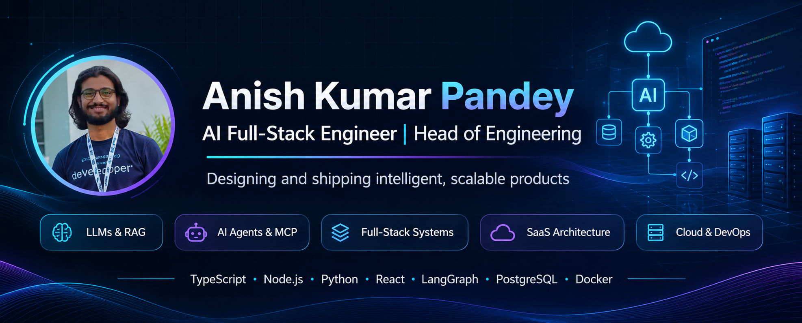
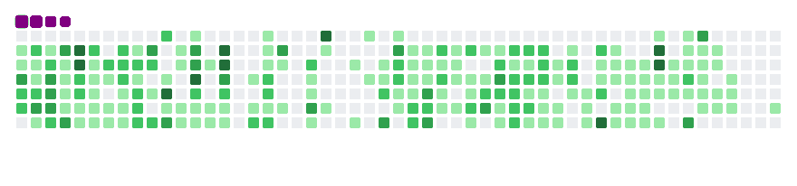

<div align="center">

# 👋 Hey there! I'm Anish Kumar Pandey


[](https://github.com/0anish0)

</div>

---

## 🚀 About Me


```typescript
const anish = {
  title: "AI Full-Stack Engineer",
  location: "India 🇮🇳",
  experience: "4+ Years",
  journey: {
    started: "College Days",
    then: "MERN Stack Developer",
    now: "AI/ML Wizard + Full Stack Engineer"
  },
  passion: [
    "🤖 Building Intelligent AI-Powred Applications",
    "💬 Crafting Smart Chatbots",
    "☁️ Cloud-Native Architectures",
    "📱 Cross-Platform Mobile Apps",
    "🌐 Scalable Web Solutions",
    "🏢 Custom CRM, ERP & Enterprise Software Solutions"
  ],
  currentFocus: "LLM Applications & RAG Systems",
  funFact: "Once debugged code at 30,000 feet ✈️☕"
};
```

### 🎯 What I Do

- 🧠 **AI & LLM Engineering**: Building production-ready AI applications using LLMs, RAG pipelines, embeddings, vector databases, LangChain, LangGraph, and model integrations.

- 🤖 **Agentic AI & Intelligent Automation**: Developing autonomous AI agents, multi-agent workflows, MCP integrations, tool calling, and intelligent business process automation.

- 📊 **LLMOps & AI Observability**: Implementing LLM tracing, monitoring, evaluation, prompt management, and performance optimization using Langfuse and LangSmith.

- 🏢 **Enterprise Software & SaaS Engineering**: Architecting and developing custom CRM, ERP, HRMS, EMR, and multi-tenant SaaS platforms with scalable backend systems and complex business workflows.

- 🌐 **Full-Stack & Mobile Engineering**: Building end-to-end web and cross-platform mobile applications using React, Next.js, TypeScript, Node.js, React Native, Flutter, and Python.

- ☁️ **Cloud, Infrastructure & DevOps**: Designing containerized, scalable architectures using Docker, Kubernetes, Redis, PostgreSQL, cloud infrastructure, and CI/CD practices.

- 🔗 **Real-Time Systems & Integrations**: Engineering APIs, WebSockets, AI-powered voice agents, telephony integrations, event-driven workflows, and third-party service integrations.

---

## 💻 Tech Arsenal

### 🤖 AI/ML & LLM Stack


### 🎨 Frontend Development


### 📱 Mobile Development


### ⚙️ Backend Development


### 🗄️ Databases & Backend Services


### 🗄️ Vector Databases & Search


### ☁️ Cloud & DevOps


### 📊 Analytics & Monitoring


### 📋 Project Management & Collaboration


### 🛠️ Development Tools


---

## 🎯 Expertise Highlights

<div align="center">

| 🤖 AI/ML Engineering | 🌐 Full Stack Development | ☁️ Cloud Architecture |
|:---:|:---:|:---:|
| LangChain & LangGraph | React, Next.js, Node.js | AWS & GCP Deployments |
| RAG Systems | TypeScript/JavaScript | Docker Containerization |
| Chatbot Development | REST & GraphQL APIs | Serverless Functions |
| LLM Integrations | Real-time Applications | CI/CD Pipelines |
| Prompt Engineering | Database Design | Infrastructure as Code |

</div>

---

## 🏆 Featured Projects

### 🚀 AI-Powered Applications
- 💬 **Intelligent Chatbot Systems**: Advanced conversational AI with context awareness
- 🔍 **RAG-based Knowledge Systems**: Semantic search and document Q&A
- 🤖 **LLM Integration Platforms**: Custom AI solutions with LangChain

---

## 🤝 Let's Connect

<div align="center">

[](https://www.linkedin.com/in/anish-kumar-pandey-57390b190/)
[](https://twitter.com/Factlogical_Ani?t=dVxCVorUxs0BguqVGLaNYA&s=08)
[](https://www.youtube.com/@Factlogical_Anish/about)
[](https://www.instagram.com/factlogical_anish/)
[](https://www.facebook.com/anih.pandey.9)

[](https://www.hackerrank.com/anishpandey4576)
[](https://leetcode.com/Anish-Kumar-Pandey/)
[](mailto:anishpandey4576@gmail.com)

</div>

---

## 💼 Open for Opportunities

<div align="center">

```diff
+ 🚀 AI Full-Stack Engineer
+ 💬 Chatbot & LLM Integration
+ ☁️ Cloud Architecture & DevOps
+ 📱 Cross-Platform Mobile App Developer
```

**Let's build something amazing together!** 

📧 **Email**: [anishpandey4576@gmail.com](mailto:anishpandey4576@gmail.com)

</div>

---

<div align="center">

### 💭 Dev Quote of the Day


### 🐍 Contribution Snake



*Snake animation will appear after GitHub Action runs*

</div>

---

<div align="center">

⭐️ From [Anish Kumar Pandey](https://github.com/0anish0)

</div>
